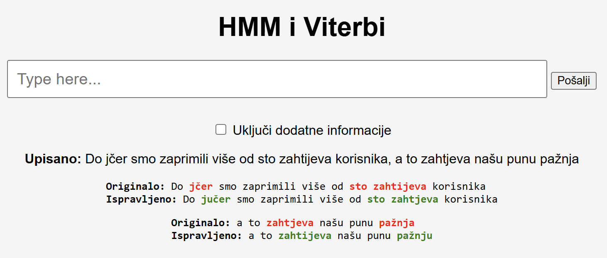
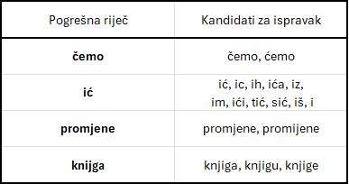
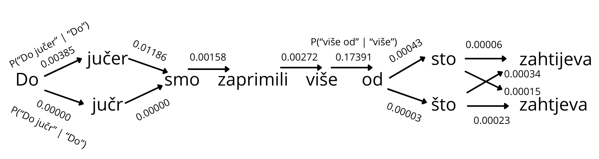

# Contextual spelling correction for Croatian (HMM + Viterbi)

Bachelor's thesis project, University of Zagreb, Faculty of Electrical Engineering and Computing (FER), 2025.

The system corrects spelling errors in Croatian text by looking at context, not just isolated words. It flags
suspicious words, generates correction candidates for them, and then uses a hidden Markov model and the Viterbi
algorithm to choose the most likely sequence of words, using n-gram frequencies from the
[Ispravi.me](https://ispravi.me) spell-checking service.

Thesis (in Croatian): *Ispravljanje pravopisnih pogrešaka primjenom Viterbijevog algoritma*,
[urn:nbn:hr:168:820197](https://urn.nsk.hr/urn:nbn:hr:168:820197)



> **Status:** access to the Ispravi.me n-gram endpoint this project was built on (`https://ispravi.me/api/ngram`)
> is now restricted. The [public Ispravi.me API](https://ispravi.me/info/api/) only offers spell checking. The code runs, but without n-gram counts it cannot produce meaningful
> corrections. See [Running it](#running-it).

## How it works

The text is split into segments at punctuation, and each segment is corrected on its own.

**1. Detection.** A word is suspicious if it occurs fewer than 100 times in the n-gram data, or if it appears in a
hand-written list of commonly confused Croatian words (`static/word_map.json`, e.g. *zahtjeva / zahtijeva*,
*plaća / plača*, *sto / što*). If two neighbouring words both look fine but their bigram occurs fewer than 50
times, the second word is marked as suspicious too. This catches real-word errors such as *sto zahtijeva*.

**2. Candidates.** For each suspicious word the system generates replacements:

- confusable words from `word_map.json`
- every č / ć / c combination, kept if it occurs more than 50 times
- words at edit distance 1 (deletion, transposition, substitution, insertion), and distance 2 if fewer than two
  candidates were found. A candidate is kept only if it is in the word list and forms an attested bigram with a
  neighbouring word.



**3. Decoding.** The candidates form the hidden states of an HMM. The original word is always one of the
candidates. The transition probability between consecutive candidates is estimated from n-gram counts:

```
P(curr | prev) = count(prev curr) / count(prev)
```

Emissions are uniform, so the choice depends only on context. The Viterbi algorithm (in log space) finds the
sequence of candidates with the highest total probability.



## Project structure

| File | Purpose |
|---|---|
| `api.py` | Ispravi.me n-gram client (cached, with a timeout) |
| `detection.py` | Tokenisation and detection of suspicious words |
| `candidates.py` | Candidate generation (confusion list, č/ć/c alternatives, edit distance) |
| `hmm.py` | Transition probabilities and Viterbi decoding |
| `app.py` | Flask web interface (in Croatian) |
| `static/word_map.json` | Commonly confused word pairs |

## Running it

Requires Python 3.10 or newer.

```bash
pip install -r requirements.txt
python app.py
```

Then open http://127.0.0.1:5000. Use `flask --app app run --debug` for development.

Two things are missing from a fresh clone:

- **N-gram counts.** Every lookup fails because access to the endpoint is restricted. The app handles this without
  crashing, but it will not suggest corrections. To run it again, `fetch_ngram_data` in `api.py` would need another source of
  unigram and bigram counts that returns `{"count": n}`.
- **The word list** (`static/types.lang.utf8`, about 1.1 million Croatian word forms) is not included. It is
  third-party data that cannot be redistributed, and the author no longer has access to it. Without it,
  edit-distance candidates are disabled and the page shows a warning.

## License

The code is released under the [MIT License](LICENSE). The thesis itself is © Dominik Gračner and is available
from the FER repository at the link above.
